# User guide

Out Of Space scans a folder and draws its contents as a treemap: every file is a rectangle, and the bigger the file, the bigger the rectangle. This guide describes the interface as it is, including the parts that are unfinished. Those are collected under [Known gaps](#known-gaps).

The screenshots show a generated demo folder, not real data. [Regenerating the screenshots](#regenerating-the-screenshots) explains how they are made.

## Opening a folder

The app starts with one button.

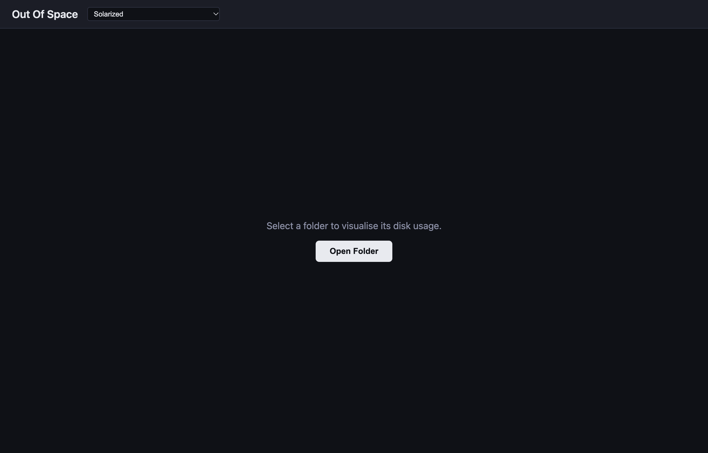

**Open Folder** shows the system folder dialog. Choosing a folder starts the scan at once.

While the scan runs, the window shows how many entries it has found and the path it is working on.

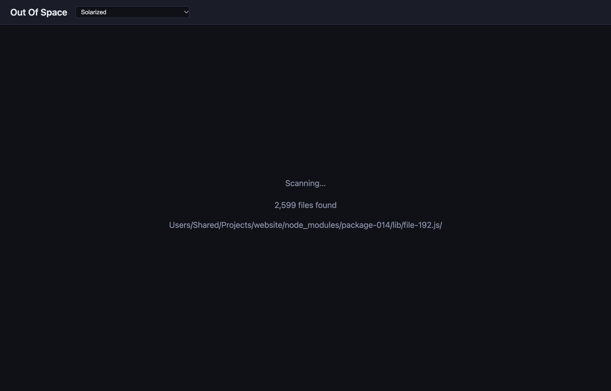

What the scan counts:

- **Size** is the length of each file as the file system reports it. A folder's size is the sum of the files below it.
- **Symbolic links** are skipped, so nothing is counted twice through a link and a link cycle cannot trap the scan.
- **Folders that cannot be read** appear empty. The app shows no message about them.

## The main window

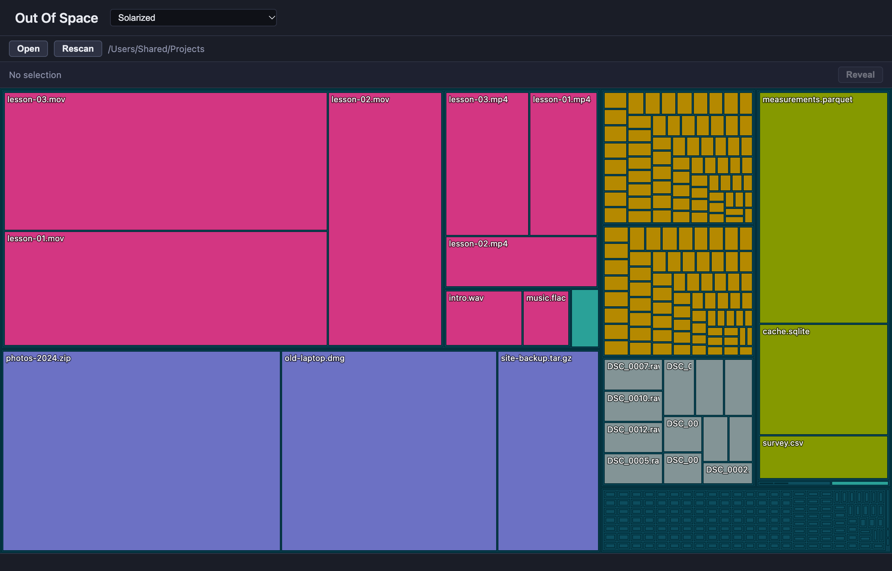

From top to bottom:

| Part | What it holds |
|---|---|
| Header | The app name and the colour palette menu. |
| Root bar | **Open**, **Rescan**, and the path of the folder in view. |
| Selection bar | The selected item as a trail of names, and the buttons that act on it. |
| Treemap | The folder in view. |
| Status bar | One line of context: a hint, a path or a size. |

## Reading the treemap

- **Area is size.** A file's rectangle is proportional to its size within the folder in view.
- **Folders are frames.** A folder is the rectangle around its contents; only a thin border of it shows. The border's shade changes with depth, over three levels.
- **Colour is file type**, taken from the file extension:

  | Type | Extensions |
  |---|---|
  | Code | ts, tsx, js, jsx, vue, py, rb, go, rs, java, c, cpp, h, hpp, cs, swift, kt, php, sh, zsh, bash, css, scss, less, html, svg, sql |
  | Image | png, jpg, jpeg, gif, webp, ico, bmp, tiff |
  | Document | pdf, md, txt, doc, docx, rtf, odt |
  | Archive | zip, tar, gz, bz2, xz, rar, 7z, dmg |
  | Media | mp4, mkv, avi, mov, mp3, wav, flac, ogg, m4a, aac |
  | Config | json, yaml, yml, toml, xml, ini, env |
  | Data | csv, tsv, parquet, sqlite, db |
  | Other | everything else |

- **Names** appear on files whose rectangle is at least about 40 by 16 points. Folders carry no name.
- **Very small items are not drawn.** Anything that would cover less than 16 square points is left out, which shows as empty folder background. Drilling into the folder gives its contents more room.

## Pointing and selecting

Moving the pointer over a rectangle shows a tooltip with its name, type and size. The status bar shows its full path.

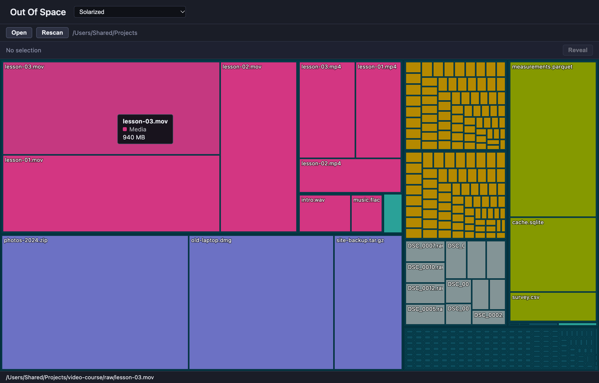

A click selects. The selected rectangle gets an outline, and the selection bar shows where it sits below the folder in view. Clicking one of the earlier names in that trail selects that folder.

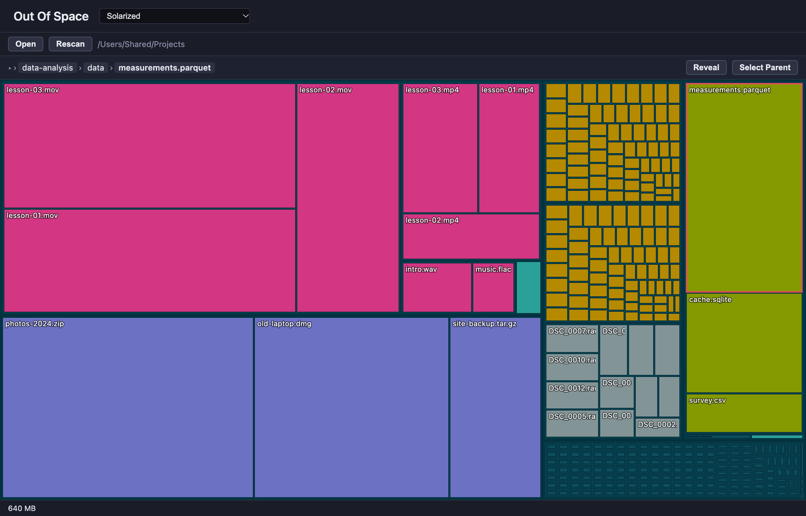

The buttons on the right act on the selection:

| Button | Shown for | What it does |
|---|---|---|
| **Reveal** | any selection | Shows the item in Finder. |
| **Terminal** | folders | Opens Terminal in that folder. |
| **Drill Into** | folders | Makes that folder the one in view. |
| **Select Parent** | anything but the scanned folder itself | Moves the selection to the enclosing folder. |

Resting the pointer on a button explains it in the status bar.

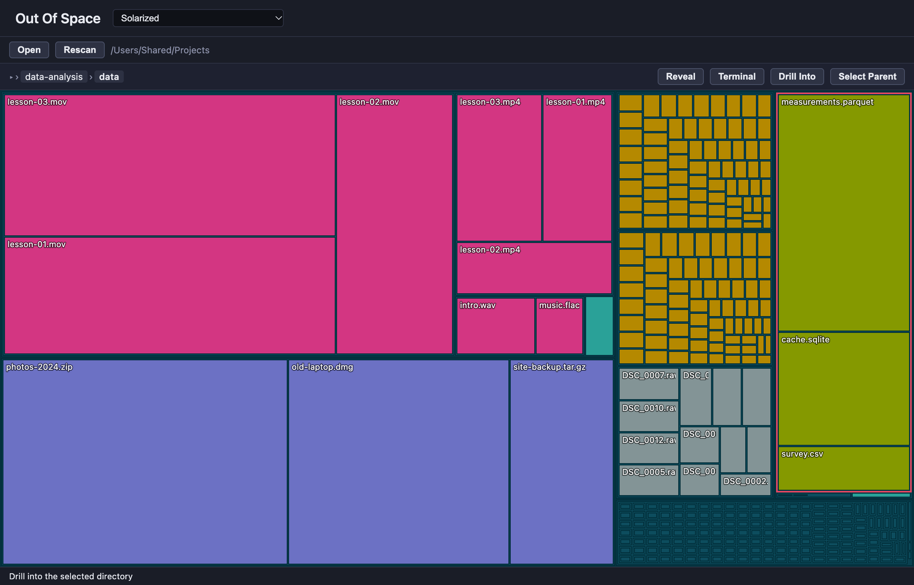

The status bar shows one thing at a time, in this order: the hint for the button under the pointer, the path of the item a context menu is open for, the path of the item under the pointer, the size of the selection.

## Moving through folders

**Into a folder**, three ways:

- Select the folder and click **Drill Into**. To select a folder, click a file inside it and use **Select Parent**.
- Select the folder and press Cmd+Down.
- Double-click the folder's border.

**Back out:**

- **Up** in the root bar moves one level. It appears only below the scanned folder.
- The names in the root bar's path are links. The grey part is the scanned folder; each name after it jumps to that level.
- Cmd+Up moves one level.

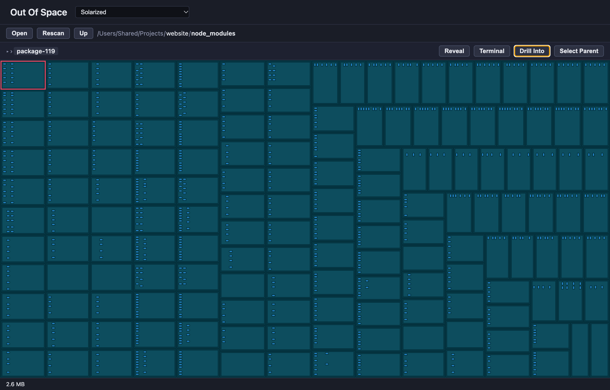

**Rescan** reads the scanned folder again. **Open** scans a different one. During a scan the previous picture stays visible under an overlay and both buttons are disabled. When the scan finishes, the view returns to the top of the scanned folder and the selection is cleared.

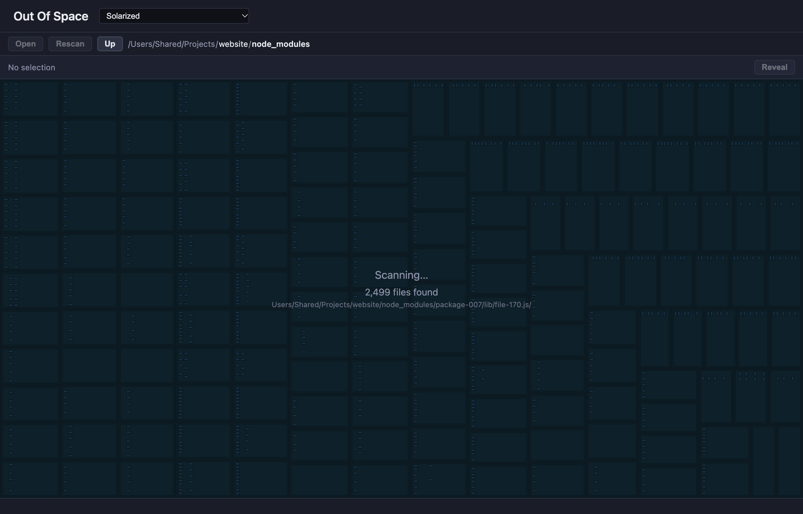

## Context menu

A right-click on a rectangle opens a menu for that item. It acts on the item under the pointer, not on the selection, and leaves the selection as it is.

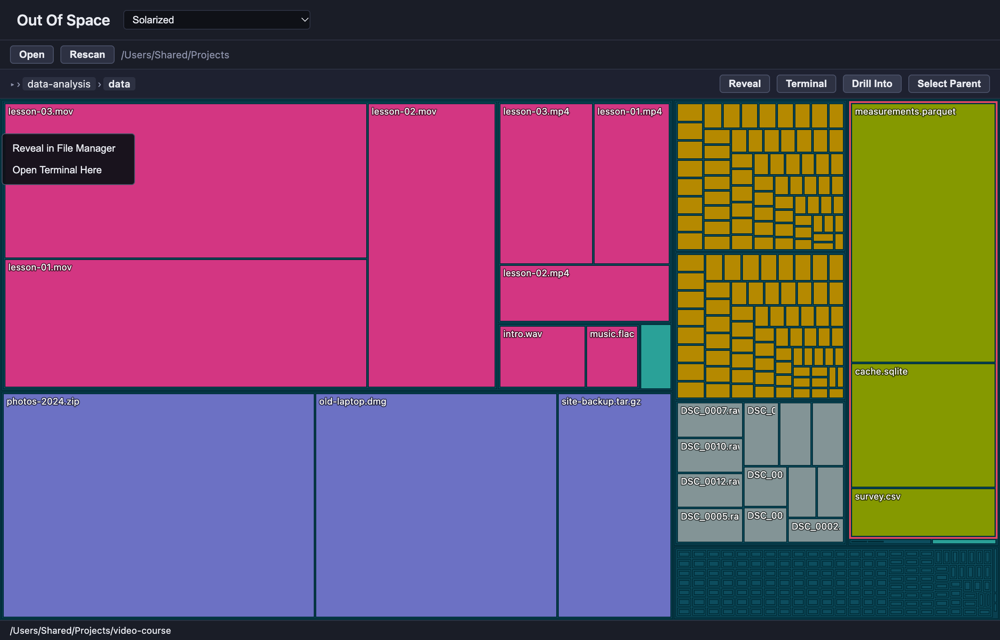

- **Reveal in File Manager** shows the item in Finder.
- **Open Terminal Here** opens Terminal in that folder. Files don't have this entry.

Escape, or a click anywhere else, closes the menu.

## Keyboard

| Key | With a selection | Without a selection |
|---|---|---|
| Arrow Down | Selects the largest item inside the selected folder. | Selects the largest item in view. |
| Arrow Up | Selects the enclosing folder. Stops at the folder in view. | Selects the folder in view. |
| Arrow Right | Selects the next smaller item in the same folder; after the smallest comes the largest. | Selects the largest item in view. |
| Arrow Left | Selects the next larger item in the same folder; before the largest comes the smallest. | Selects the folder in view. |
| Cmd+Down | Drills into the selected folder. | |
| Cmd+Up | Moves the view up one level. | Same. |
| Escape | Closes the context menu. | Same. |

Ctrl works in place of Cmd.

## Appearance

The window follows the system's light or dark appearance.

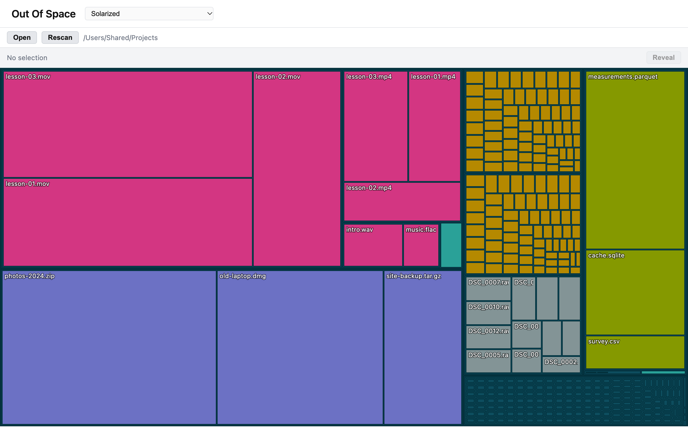

The treemap has its own colours, chosen in the palette menu in the header. There are four palettes; the choice lasts until the app quits.

| | |
|---|---|
| 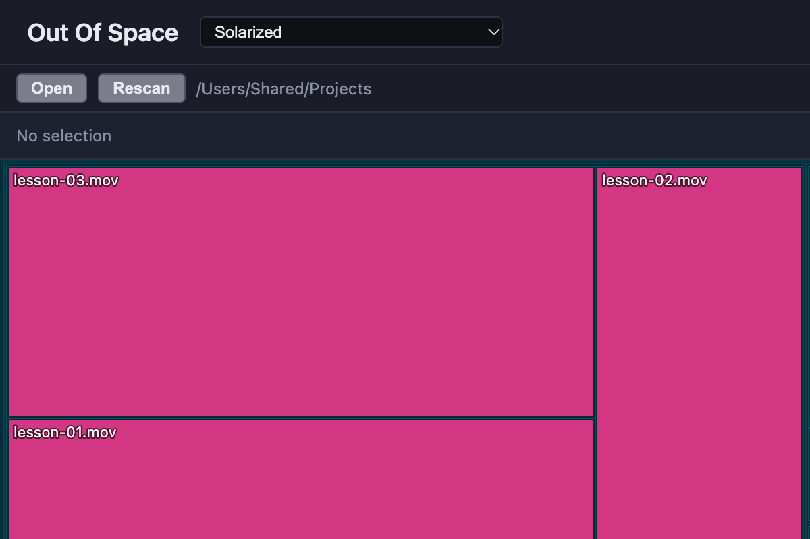 | 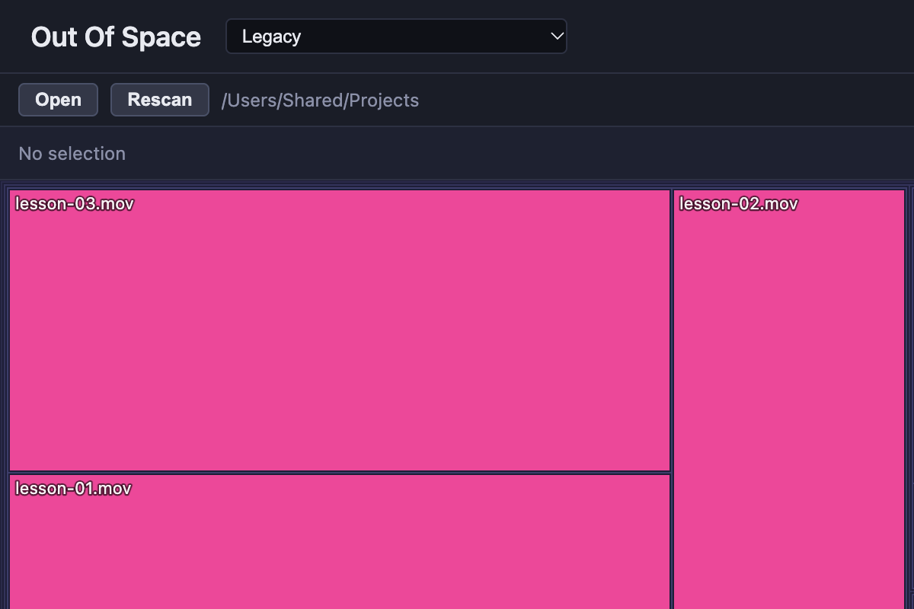 |
| 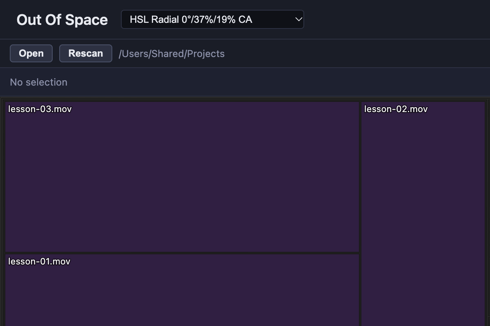 | 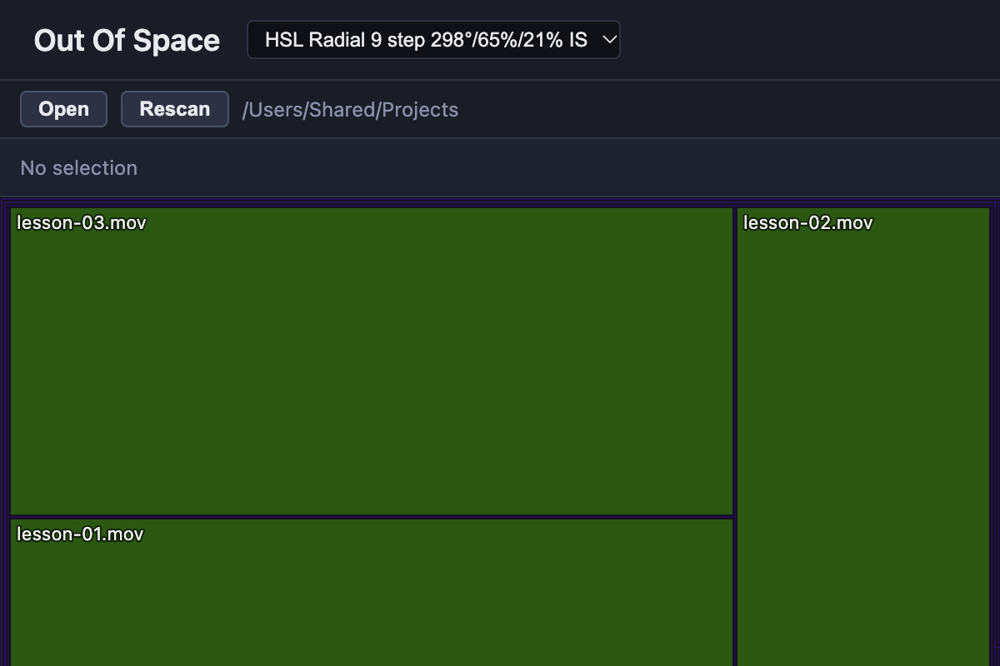 |

## Window and menus

- **One window**, 1200 by 800 points at start, at least 800 by 600.
- **The menu bar is Electron's standard one.** It has no entries of the app's own, so opening a folder and rescanning are available only as buttons.
- **About Out Of Space**, in the application menu, shows the version together with the commit and the build time.
- **Closing the window does not quit the app.** A click on the Dock icon opens a new, empty window.

## Known gaps

The state of the interface when this guide was written. Each item was checked in the running app unless it says otherwise.

**Getting around**

- Drilling in by double-click needs the folder's thin border as a target ([#18](https://github.com/idlinglight/out-of-space/issues/18)). A double-click on a file does nothing.
- There is no key for "drill into" other than Cmd+Down; Enter does nothing.
- The arrow keys can select an item that is too small to be drawn. The selection bar names it, the treemap shows no outline ([#34](https://github.com/idlinglight/out-of-space/issues/34); not re-checked here).
- Arrow Up followed by Arrow Down lands on the largest item, not on the one the selection came from ([#36](https://github.com/idlinglight/out-of-space/issues/36)).
- While the palette menu has the keyboard focus, the arrow keys do nothing in the treemap. The menu keeps the focus after a palette is chosen, until a click elsewhere (checked with the focus placed on the menu).
- With the context menu open, the arrow keys still move the selection behind it.
- **Drill Into** is offered when the selection is the folder already in view, where it does nothing.
- A selection can be changed but not cleared, short of a rescan.

**Feedback**

- A failed scan is silent. If the folder can't be read, the window stays as it was. The app records the error and no view shows it.
- During a scan, the path line shows its leading slash at the end (`Users/…/file.js/`). The line is laid out right to left so that long paths keep their end visible, and that moves the slash.
- The count during a scan says "files found" and includes folders.
- With a selection and the pointer elsewhere, the status bar shows the selection's size and not its path.
- Folders are never named in the treemap. A view made of folders, like the `node_modules` picture above, has no names at all.
- The selection outline is red. On the Solarized palette's magenta media files it is hard to see.
- The size shown is file length, not space taken on disk. Sparse files, clones and hard links are counted at full length each; the demo folder claims about 9 GB and takes almost none.

**State**

- **Rescan** returns the view to the top level and clears the selection.
- The palette is not remembered between launches. Two of the four palettes carry working names (`HSL Radial 0°/37%/19% CA`).
- **View → Reload** (Cmd+R) is part of the standard menu and throws the scan away. So does closing the window ([#4](https://github.com/idlinglight/out-of-space/issues/4)).

**Naming**

- The same two actions are "Reveal" and "Terminal" on the buttons, "Reveal in File Manager" and "Open Terminal Here" in the context menu, and "Show in Finder" and "Open in Terminal" in the project documents.

**Described elsewhere, not in the app**

- Dropping a folder on the window. Nothing in the app handles a drop; what a drop does was not tested.
- Switching the visualisation mode, which the README lists as a feature. The sunburst view is a placeholder, and no control switches to it.

## Regenerating the screenshots

```sh
npm run build
node docs/user-guide/capture.mts /Users/Shared/Projects
```

[`capture.mts`](user-guide/capture.mts) generates the demo folder at the given path, drives the built app with Playwright's Electron driver, writes the pictures next to itself and removes the folder again. The path must not exist beforehand. It appears in the pictures, so pick a neutral one.

- The demo files are sparse, so the folder takes almost no disk space.
- For the two pictures of a running scan, the script slows file access down; the scan would otherwise be over before the picture is taken. What the app shows is unchanged by that.
- The folder dialog, the menu bar and the window frame are drawn by macOS and are not in the pictures.
